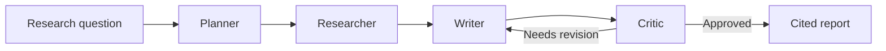

# Project 05: Multi-Agent Research Pipeline

> **Difficulty:** Advanced · **Focus:** Agent orchestration, handoffs, and sub-agents · **Status:** Skeleton / starter project

Build a multi-agent system that researches a topic, synthesizes findings, fact-checks, and produces a cited report.

## Architecture



## Stack
- Python 3.11+
- OpenAI and Anthropic SDKs
- Pydantic
- pytest and Ruff

## Getting started

```bash
make install
cp .env.example .env
# Add your API key(s) to .env
make run
```

Run checks:
```bash
make test
make eval
make lint
```

## Project structure

```text
.
├── src/                 # Agent application
├── tests/               # Smoke tests
├── evals/               # Golden dataset and evaluation runner
├── .env.example         # Environment variable template
├── Dockerfile
├── DEPLOYMENT.md
├── Makefile
└── pyproject.toml
```

## Important note
This repository currently contains a starter skeleton. The agent implementation, real evaluation cases, and production deployment configuration still need to be completed. Do not treat the placeholder eval dataset as meaningful benchmark results.

## Source and attribution
This project is based on the public starter project in [AdilShamim8/GenAI-Roadmap-with-Notes-and-Projects](https://github.com/AdilShamim8/GenAI-Roadmap-with-Notes-and-Projects/tree/main/projects/05-multi-agent-research-pipeline). Please review the original repository's license and retain required attribution before redistributing or presenting this as your own work.
